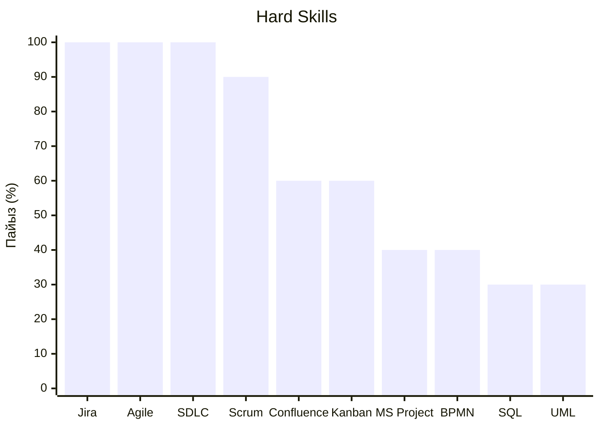
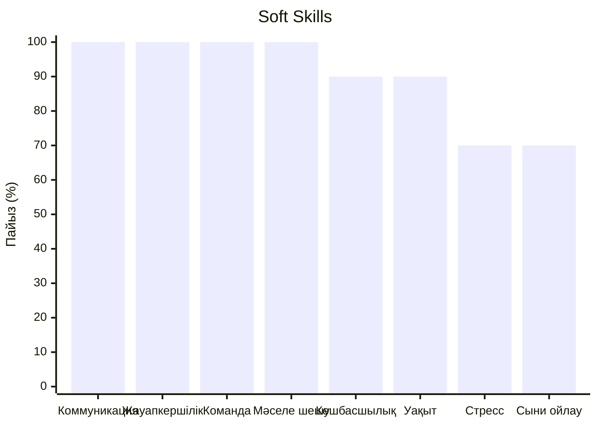

# IT Project Manager дағдыларының диаграммасы

## 1. Диаграмманың мақсаты

Бұл диаграмманың мақсаты — IT Project Manager мамандығына қажетті Hard Skills және Soft Skills дағдыларының жиілігін визуалды түрде көрсету.

## 2. Hard Skills диаграммасы

## 3. Soft Skills диаграммасы

## 4. Диаграмма нәтижелерін талдау

Hard Skills ішінде Jira, Agile және SDLC көрсеткіштері жоғары.

Soft Skills ішінде коммуникация, жауапкершілік, командамен жұмыс және мәселелерді шешу қабілеттері маңызды.

## 5. Қорытынды

Диаграмма IT Project Manager маманы үшін техникалық және жеке дағдылардың екеуі де маңызды екенін көрсетеді.

Болашақ маман Jira, Agile, Scrum құралдарын меңгеріп, коммуникация және басқарушылық қабілеттерін дамытуы қажет.

## 6. Ескерту

Диаграммадағы көрсеткіштер алдын ала матрицаға негізделген. Нақты зерттеу нәтижесі ретінде пайдалану алдында әр вакансияның жеке сипаттамасы бойынша тексеру қажет.
